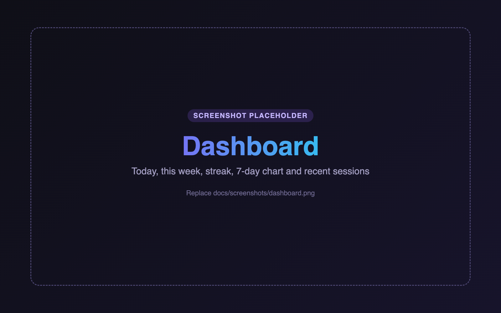
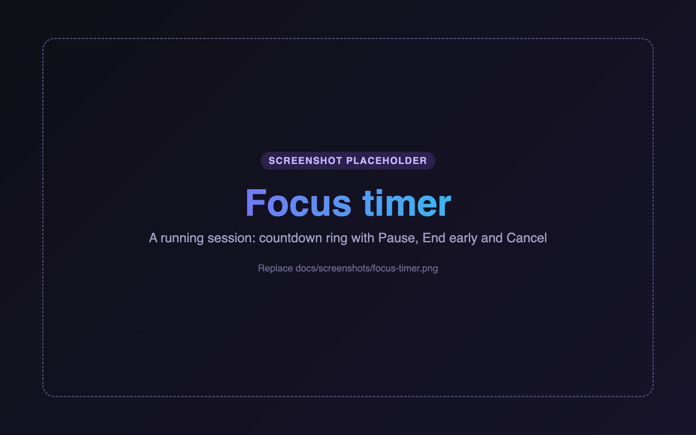

# Focus Tracker

Track how much time you spend focusing on studying, work, meditation or
personal projects. Run focus sessions in your browser or terminal, review your
history, and get weekly insights written by Claude.

### 🚀 [Try the live demo →](https://focus-tracker-demo.onrender.com)

No account or installation needed: it runs in your browser.

**Contents:** [Live Demo](#live-demo) · [Overview](#project-overview) · [Features](#features) ·
[Screenshots](#screenshots) · [Installation & Setup](#installation--setup) ·
[AI Weekly Insights](#ai-weekly-insights) · [Original CLI](#original-cli) ·
[Technologies](#technologies-used)

---

## Live Demo

**[focus-tracker-demo.onrender.com](https://focus-tracker-demo.onrender.com)**

- **Start exploring right away.** The demo comes with sample activities and
  focus sessions, tagged *Sample*.
- **Make it your own.** Create activities, run and pause focus sessions,
  record reflections, locations and distractions, and see the dashboard and
  history update.
- **Real AI insights.** Generate a weekly report written by Claude from your
  current data. Reports are rate-limited to keep costs low.
- **Private to your browser.** Each visitor's data is stored separately in
  their own browser, and nothing is saved on the server. No account or
  installation is required.

> **Note:** the demo is hosted on Render's free plan, so after a period of
> inactivity the first page load can take up to a minute while the server
> wakes up.

## Project Overview

**Artifact 2** was a Python command-line focus tracker. It ran timed sessions
with a live countdown, kept a session history and reported statistics, using
only the standard library.

**Artifact 3** expands it into a **full-stack web application**:

- **A FastAPI backend and a responsive browser interface.** The web app shares
  one data file with the CLI, so a session started in either appears in both.
- **Richer session tracking.** Each session can record a location, distractions
  and a reflection.
- **AI-generated weekly insights.** Python calculates the statistics, and
  Claude turns them into a short, personalized report.

## Features

- ⏱️ **Interactive focus timer.** Preset or custom durations, a countdown ring,
  pause/resume, end early, keyboard shortcuts and a completion chime.
- 🗂️ **Activity and session management.** Create, rename and delete
  activities, and log sessions you forgot to time.
- 📜 **Session history.** Sessions grouped by day, with search, filters and a
  details view.
- 📊 **Productivity dashboard.** Daily and weekly totals, your streak, a 7-day
  chart and recent sessions.
- 📝 **Reflections, locations and distractions.** Record where you worked and
  how each session went.
- ✨ **AI weekly insights.** A concise, evidence-based report powered by Claude.
- 🌗 **Dark/light mode and responsive design.** Works on desktop, tablet and
  phone.

## Screenshots

> **Note:** these are placeholders. Replace each file in
> [`docs/screenshots/`](docs/screenshots/), keeping the same name.

### Dashboard


### Focus Timer


### AI Insights


## Installation & Setup

**Requirements:** Python 3.10+ and Git. An
[Anthropic API key](https://console.anthropic.com/) is optional and only needed
for AI insights.

**1. Clone the repository**

```bash
git clone https://github.com/hsheik20/Study-time-tracker.git
cd Study-time-tracker
```

**2. Create a virtual environment and install dependencies**

```bash
python3 -m venv .venv
source .venv/bin/activate          # Windows: .venv\Scripts\activate
pip install -e ".[web]"
```

**3. Configure your API key (optional)**

Create a `.env` file in the project folder:

```dotenv
ANTHROPIC_API_KEY=your-api-key-here
```

`.env` is git-ignored, and the key stays on the server: it's never sent to the
browser. Without a key, everything except AI insights works normally.

**4. Launch the web app**

```bash
focus web                          # opens http://127.0.0.1:8000
```

You can also run `python -m focus_tracker.web`. Use `--port 8080` to change
the port, or `--no-browser` to skip opening a tab.

## AI Weekly Insights

On the **AI Insights** page, click **Generate Weekly Insights** to have Claude
(`claude-haiku-5-5`) analyze your week:

- **What it looks at:** focus time, completion rates, time of day, activities,
  locations, distractions, trends over recent weeks, and your notes and
  reflections.
- **What you get:** a weekly overview, focus patterns, distraction analysis,
  your top strengths and areas to improve, and three recommendations for next
  week.
- **How it stays accurate:** Python calculates every number, and Claude only
  interprets them. Each point is labelled **Observed** (shown directly by the
  data) or **Interpretation** (a likely explanation). With limited data, the
  report keeps its conclusions tentative.
- **Privacy and cost:** only weekly totals and a trimmed sample of notes are
  sent to the API. Reports are generated only when you ask, are rate-limited,
  and are saved on your computer.

## Original CLI

The Artifact 2 command-line app is still included and needs no third-party
packages:

```bash
python3 -m focus_tracker           # interactive menu
```

If you installed the project, `focus` opens the same menu. Commands such as
`focus start studying -m 50`, `focus log` and `focus summary week` are also
available; run `focus --help` to see them all. Sessions are stored in
`~/.focus_tracker/sessions.json`, which the CLI and web app share.

## Technologies Used

| Area | Stack |
|---|---|
| **Backend** | Python 3.10+, FastAPI, Uvicorn, Pydantic |
| **AI** | Anthropic Python SDK (Claude Haiku 5.5, structured outputs), python-dotenv |
| **Frontend** | HTML, CSS and vanilla JavaScript (ES modules, no build step), Web Audio API |
| **CLI** | Python standard library (argparse, ANSI terminal rendering) |
| **Storage** | Local JSON file with atomic writes and file locking |
| **Testing** | unittest, FastAPI TestClient, mocked Anthropic client |

To run the tests:

```bash
pip install -e ".[dev]"
python -m unittest discover -s tests
```
